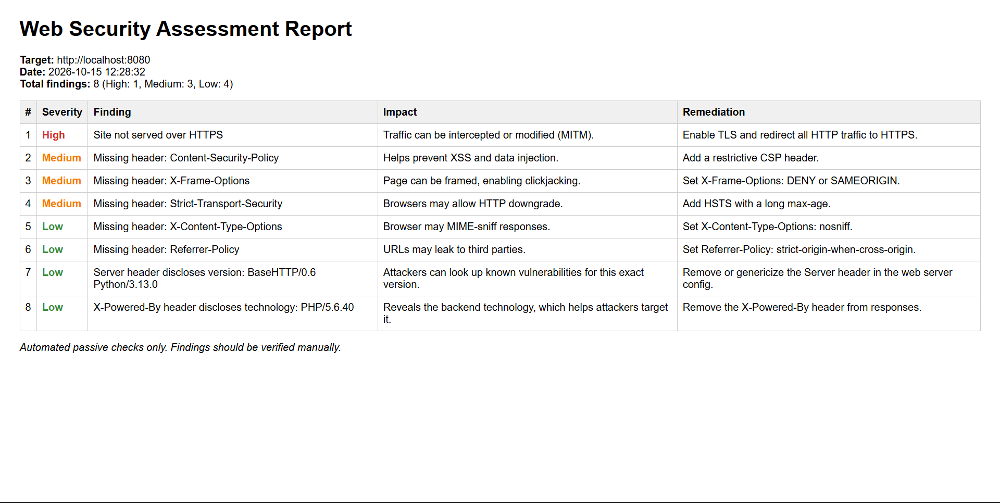

# Automated Web Security Assessment Tool

A Python-based scanner that performs passive security checks on a web application and generates a report with severity, impact, and remediation for each finding.



## Features
- HTTPS usage check
- Security header analysis (CSP, X-Frame-Options, HSTS, X-Content-Type-Options, Referrer-Policy)
- Cookie flag checks (Secure, HttpOnly, SameSite)
- Server information disclosure (Server, X-Powered-By, and similar headers)
- Risky HTTP methods via OPTIONS (PUT, DELETE, TRACE, CONNECT)
- Severity-sorted Markdown and HTML reports

## Requirements
- Python 3.9 or newer
- `requests` library (installed through `requirements.txt`)

## Setup
```bash
git clone https://github.com/Viznu567/web-security-scanner.git
cd web-security-scanner
python -m venv venv
venv\Scripts\activate
pip install -r requirements.txt
```

## Usage
```bash
python scanner.py http://localhost:8080
python scanner.py http://localhost:8080 --no-report
```

## Testing safely
`test_server.py` starts a simple local server on port 8080, so you can try the scanner without touching anyone else's systems. It is served over plain HTTP, sends no security headers, and reveals technology details in its response headers.

Start it in one terminal:
```bash
python test_server.py
```

Then scan it from a second terminal:
```bash
python scanner.py http://localhost:8080
```

Expected result: 8 findings (High: 1, Medium: 3, Low: 4).

## Sample output
```
[+] Final URL: http://localhost:8080/
[+] Status code: 200

[High] Site not served over HTTPS
[Medium] Missing header: Content-Security-Policy
[Medium] Missing header: X-Frame-Options
[Medium] Missing header: Strict-Transport-Security
[Low] Missing header: X-Content-Type-Options
[Low] Missing header: Referrer-Policy
[Low] Server header discloses version: BaseHTTP/0.6 Python/3.13.0
[Low] X-Powered-By header discloses technology: PHP/5.6.40

[+] Total findings: 8 (High: 1, Medium: 3, Low: 4)
```
A full HTML report from this scan is in `sample_reports/sample_report.html`.

## How it works
The scanner sends normal GET and OPTIONS requests, reads the response headers and cookies, compares them against common security best practices, and ranks each finding as High, Medium or Low.

## Limitations
- Checks are passive and based on response headers.
- It scans one URL at a time and does not crawl the site.
- Results can include false positives and should be verified manually.

## Future improvements
- Scan multiple URLs from a file
- JSON report output
- Additional checks such as TLS version and certificate validity

## Disclaimer
Use only on systems you own or have written permission to test. This tool does not exploit anything.